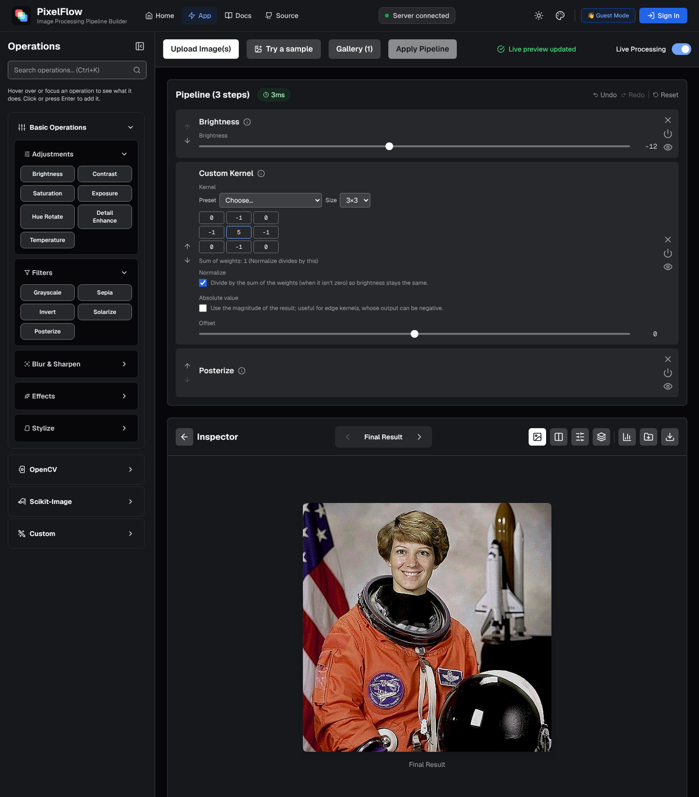
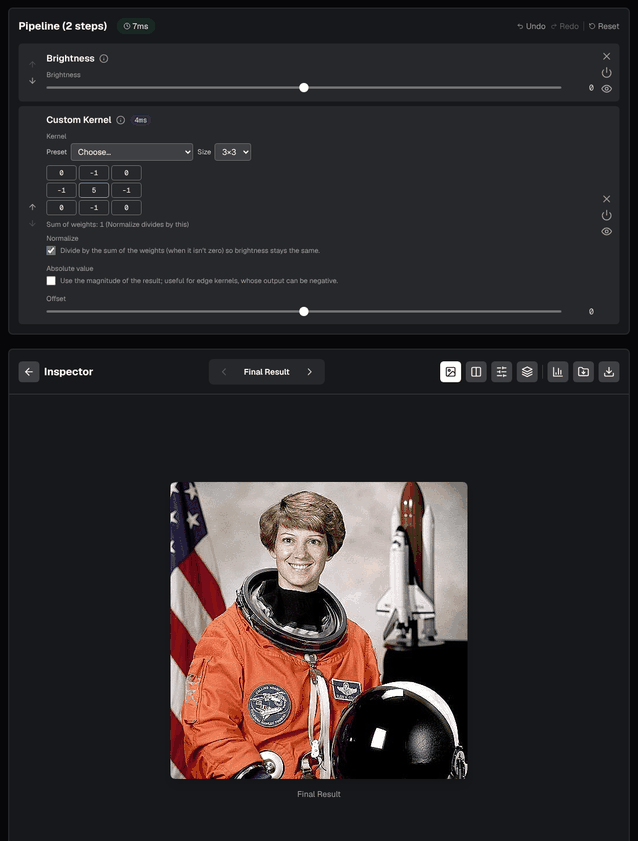
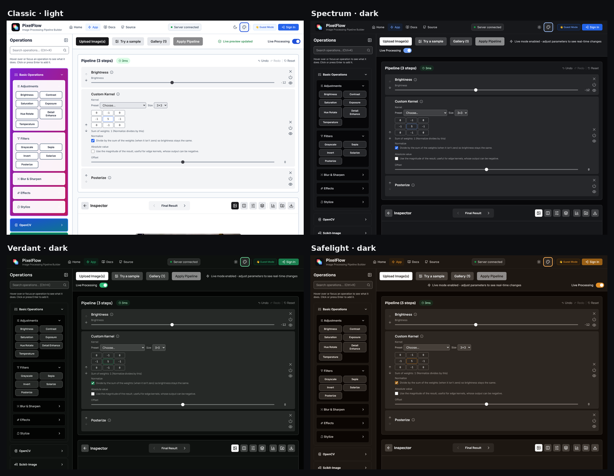
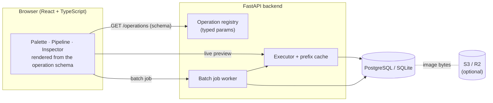

<div align="center">


# PixelFlow

**Build image processing pipelines visually.**<br />
Chain 77 OpenCV, scikit-image and Pillow operations, preview every step live, design your own filters, and batch-process images. No code required.

[](https://github.com/Mauryantitans/PixelFlow/actions/workflows/ci.yml)
[](LICENSE)
[](https://pixel-flow-woad.vercel.app)
[](a11y-reports/REPORT.md)
<br />
[](backend/)
[](backend/)
[](frontend/)
[](CONTRIBUTING.md)

[**Try it live**](https://pixel-flow-woad.vercel.app) · [Getting started](guides/GETTING_STARTED.md) · [API](guides/API_REFERENCE.md) · [Report a bug](https://github.com/Mauryantitans/PixelFlow/issues/new?template=bug_report.yml) · [Request a feature](https://github.com/Mauryantitans/PixelFlow/issues/new?template=feature_request.yml)

<br />



</div>

---

## Why PixelFlow?

Tuning an image-processing pipeline usually means editing a script, re-running it, and squinting
at the output. PixelFlow turns that loop into a direct-manipulation tool:

- **See every step.** Move a slider and the preview updates; inspect the output of any step,
  wipe between before and after, or diff two steps.
- **Real algorithms.** 77 operations from OpenCV, scikit-image and Pillow, from basic
  adjustments to edge detection, morphology, denoising and segmentation, with typed parameters.
- **Make it yours.** Write your own convolution kernels and per-pixel formulas, save any pipeline as a reusable filter,
  and share pipelines with a link.
- **For everyone.** Runs in the browser, works with a keyboard and screen reader (WCAG 2.1 AA),
  down to 320px wide, in seven themes.

<p align="center">
  
</p>

## Features

| | |
|---|---|
| **Build** | 77 operations in a searchable palette · reorder with buttons or Alt+↑/↓ · undo/redo · switch a step off without deleting it · interactive inputs: click a seed point, drag a region, pick a colour on the image |
| **Preview** | Live mode re-runs only the steps after your edit (prefix cache) · per-step timings · Inspector with step-by-step view, compare slider, diff and histograms |
| **Customize** | **Custom Kernel** editor (3×3 to 9×9, presets for blur, sharpen, edges, emboss, Sobel) · **Expression**: your own per-pixel formula per channel (`0.3*r + 0.59*g + 0.11*b`), evaluated safely on the server · save a pipeline as **your own filter** and add it as one step |
| **Batch** | Process many images as a background job · results stream in · survives a page reload · download all as ZIP |
| **Share** | Save pipelines to your account · public pipelines · **share by link** (viewers open the steps in their own workspace; images are never shared) |
| **Accounts** | Email + password or Google · password reset · email verification · httpOnly-cookie sessions with CSRF protection |
| **Look and feel** | Seven themes (Classic, Spectrum, Verdant, Cobalt, Fjord, Orchid, Safelight), each light and dark, saved to your account · sample images to start with · drag-and-drop upload |
| **Operate** | Admin panel (quotas, retention, users) behind a server-side PIN · automatic cleanup · optional S3/R2 image storage · error reporting (optional Sentry) · uptime check |

<p align="center">
  
</p>

## Quick start

**Fastest (SQLite, hot reload):**

```bash
git clone https://github.com/Mauryantitans/PixelFlow.git
cd PixelFlow
./start.sh          # Windows: start.bat
```

**With PostgreSQL (Docker):**

```bash
docker compose up
```

Then open <http://localhost:3000> (API docs at <http://localhost:8000/docs>). To get an admin
account, set `ADMIN_EMAIL` and `ADMIN_PASSWORD` in `backend/.env` before starting; there are no
default credentials. Manual setup and troubleshooting: [INSTALLATION.md](INSTALLATION.md).

## How it works



Operations are declared **once, in the backend**: each is a Python function plus a typed
parameter schema. The UI renders every control from `GET /api/processing/operations`, so adding
an operation needs no frontend change ([how](guides/ADDING_OPERATIONS.md)). Coordinates are
normalized, so a point picked before a Resize still lands in the right place. The full tour is in
[CLAUDE.md](CLAUDE.md#architecture).

| Layer | Technology |
|---|---|
| Frontend | React 18, TypeScript, Tailwind CSS (themes via CSS variables), Axios, Lucide icons |
| Backend | FastAPI, SQLAlchemy 2, Alembic, Pydantic 2 |
| Image processing | OpenCV, scikit-image, Pillow, NumPy |
| Data | PostgreSQL (production), SQLite (local), optional S3-compatible storage |
| Auth | JWT in httpOnly cookies, CSRF double-submit, refresh rotation, Google OAuth |
| Quality | pytest, ruff, mypy, Jest, Puppeteer browser checks, Lighthouse + axe-core in CI |
| Hosting | Vercel (frontend) + Render (backend, PostgreSQL); Docker for self-hosting |

## Documentation

| | |
|---|---|
| [Getting started](guides/GETTING_STARTED.md) | Using the app: pipelines, live vs batch, custom filters, sharing |
| [Installation](INSTALLATION.md) | Local setup and troubleshooting |
| [API reference](guides/API_REFERENCE.md) | Auth, images, processing, jobs, pipelines, admin |
| [Adding operations](guides/ADDING_OPERATIONS.md) | Register a new operation in about 20 lines |
| [Deployment](deployment/DEPLOYMENT_GUIDE.md) · [Env vars](deployment/ENVIRONMENT_VARIABLES.md) | Render + Vercel, every environment variable |
| [Admin panel](guides/ADMIN_PANEL.md) · [Database](guides/DATABASE_SETUP.md) | Operating an instance |
| [Accessibility report](a11y-reports/REPORT.md) | WCAG 2.1 AA audit, per-theme results |
| [Changelog](CHANGELOG.md) · [Known limitations](CURRENT_LIMITATIONS.md) | What changed and what's next |

## Testing and quality

Every push runs the [CI workflow](.github/workflows/ci.yml):

- **Backend:** `ruff`, `mypy`, and the `pytest` suite (operations, executor, migrations, auth,
  sessions, jobs, storage, sharing).
- **Frontend:** strict TypeScript, Jest, and the production build with ESLint warnings as errors.
- **Browser checks:** a fresh stack is started and six Puppeteer scripts drive real workflows
  (uploads, live preview, batch jobs, custom filters, sharing, sessions, themes), followed by a
  Lighthouse + axe-core accessibility audit of 24 screens in light and dark mode.

Run them locally: see [CONTRIBUTING.md](CONTRIBUTING.md).

## Roadmap

Ideas and known gaps live in [CURRENT_LIMITATIONS.md](CURRENT_LIMITATIONS.md) and the
[issue tracker](https://github.com/Mauryantitans/PixelFlow/issues). Next up: more operations, processing
history, and a friendlier first load while the free-tier server wakes up.

## Contributing

Contributions of all sizes are welcome: new operations, bug fixes, docs and design. Start with
[CONTRIBUTING.md](CONTRIBUTING.md), and please follow the [code of conduct](CODE_OF_CONDUCT.md).
Found a security issue? See [SECURITY.md](SECURITY.md) and report it privately.

## Acknowledgements

Built on [OpenCV](https://opencv.org/), [scikit-image](https://scikit-image.org/),
[Pillow](https://python-pillow.org/), [FastAPI](https://fastapi.tiangolo.com/) and
[React](https://react.dev/). Sample images are public-domain/CC0 photos bundled with
scikit-image ([credits](frontend/public/samples/CREDITS.md)). Typefaces from Google Fonts.

## Contact

| | |
|---|---|
| GitHub | [@Mauryantitans](https://github.com/Mauryantitans) |
| LinkedIn | [mourya-arnepalli](https://www.linkedin.com/in/mourya-arnepalli) |
| Instagram | [@mouryaarnepalli](https://www.instagram.com/mouryaarnepalli) |

Questions and ideas: [GitHub Issues](https://github.com/Mauryantitans/PixelFlow/issues).

## License

[Apache License 2.0](LICENSE). If you use PixelFlow in research, GitHub's **Cite this repository**
button (from [CITATION.cff](CITATION.cff)) gives a ready-made citation.
